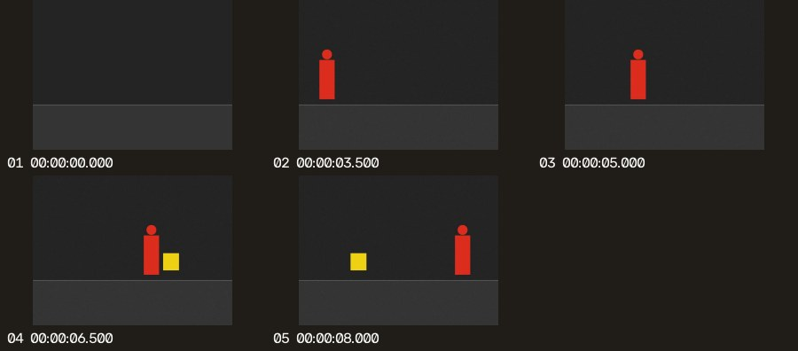

# Skim a video in Codex with Video AI Saver

[中文](CODEX.md)

Give Codex a local video path. **Video AI Saver** checks for visual changes and returns a timestamped contact sheet and a small set of still images. Use it to locate screen transitions, find changes in a walkthrough, or make a review list. The script reads the original video locally; when you ask Codex to interpret the footage, it can inspect only the selected images.

## Install

You need Git, a Codex CLI version with `codex plugin` support, and Python 3.9 or later. Run in PowerShell or a terminal:

```sh
git clone https://github.com/x549d/video-ai-saver.git
cd video-ai-saver
python -m pip install "opencv-python-headless>=4.8" "numpy>=1.23"
codex plugin marketplace add ./codex-plugin
codex plugin add video-ai-saver@cascade-vision
codex plugin list --marketplace cascade-vision
```

If you already cloned the repository, run the three `codex` commands from its root. Make sure the Python environment Codex will use can import `cv2` and `numpy`; install the dependencies above if needed. Local screening needs no API key, YOLO weights, or external service. Start a new local Codex chat after installation. If the plugin does not appear in the desktop app, restart the app and try again.

To update, run `git pull --ff-only` in this repository, then run `codex plugin add video-ai-saver@cascade-vision` again to install the latest copy from the same local source.

## Use it

In a new Codex chat, select the **video-triage** skill from **Video AI Saver**, or name the plugin in your prompt. Use a local MP4, MOV, M4V, MKV, WebM, or AVI file that Codex can read.

> Use Video AI Saver to skim `~/Videos/walkthrough.mp4`. Pick up to eight frames, tell me when the interface changes, and link the contact sheet.

You can ask for frame extraction without visual interpretation. You can also run the same script before installing the plugin:

```sh
python codex-plugin/plugins/video-ai-saver/skills/video-triage/scripts/triage_video.py "path/to/video.mp4" --max-frames 8
```

To try it without your own video, install this project with `python -m pip install -e .`, run `python examples/generate_fixture.py --output-dir reports/fixture`, then pass `reports/fixture/synthetic.avi` to the plugin.

## Read the results

Each run creates a fresh folder under `reports/video-triage/` in the working directory:

| File | What it's for |
| --- | --- |
| `contact-sheet.jpg` | Skim the selected frames and use the numbered timestamps to seek in the original video. |
| `frames/*.jpg` | Open an individual frame to inspect the UI or other details. |
| `manifest.json` | Feed frame paths, timestamps, and selection reasons into a script or AI tool. `opening_context` marks the first preview; `visual_change` marks a detected change. |



The example scored 20 of 300 frames and selected five. A red shape is visible at `00:00:03.500` and a yellow shape at `00:00:06.500`. These are the first **selected** images that show the shapes, so their true appearance times may be earlier.

The default is two samples per second and up to 12 output frames. Screening may miss subtle changes, static details, brief events, and anything audible; camera movement and lighting changes can trigger selection. Try `--sample-fps 4` for quicker events or `--min-change 0.01` for subtler changes. The change score is a pixel-change ratio, not event confidence or a measurement of Codex usage savings.

In one GPT‑6.1 Sol comparison on the same synthetic video, with the same question and frame dimensions, the 20 evenly spaced images used **23,405** input tokens; the five selected images used **17,450** (**25.44% fewer**). Only individual frames were submitted. The baseline had 12,544 cached input tokens and the filtered run had none. The filtered run also missed the frame showing both shapes gone. These measurements from one synthetic clip do not establish savings in subscription allowance or cost.
