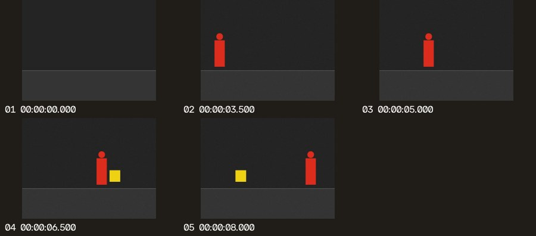

# 用 Video AI Saver 在 Codex 里先筛视频，再看重点帧

[English](CODEX.en.md)

给 Codex 一段本地视频的路径，**Video AI Saver** 会先快速检查画面变化，再给 Codex 一张带时间戳的缩略图总览和少量单帧。适合从软件录屏里找页面切换、从操作录像里定位画面变化，或先整理一份回看清单。原视频由本地脚本读取；你让 Codex 解读画面时，它只需查看选中的图片。

## 安装

需要 Git、支持 `codex plugin` 的 Codex CLI 和 Python 3.9 或更高版本。在 PowerShell 或终端运行：

```sh
git clone https://github.com/x549d/video-ai-saver.git
cd video-ai-saver
python -m pip install "opencv-python-headless>=4.8" "numpy>=1.23"
codex plugin marketplace add ./codex-plugin
codex plugin add video-ai-saver@cascade-vision
codex plugin list --marketplace cascade-vision
```

如果已经克隆仓库，从项目根目录执行后三条 `codex` 命令即可注册、安装和检查插件；确认 Codex 运行时使用的 Python 能 `import cv2, numpy`，缺少时先执行上面的安装依赖命令。粗筛不需要 API 密钥、YOLO 模型或外部服务。安装后新开一个本地 Codex 对话；如果桌面端还没显示插件，重启后再试。

更新时，先在该仓库运行 `git pull --ff-only`，再运行 `codex plugin add video-ai-saver@cascade-vision` 从同一个本地源安装最新副本。

## 用法

在新开的 Codex 对话中选择 **Video AI Saver** 的 **video-triage** 技能，或在提示里明确写出插件名。视频需要是 Codex 能读取的本地文件（MP4、MOV、M4V、MKV、WebM 或 AVI）。

> 用 Video AI Saver 粗筛 `C:\Videos\操作演示.mp4`。先挑出最多 8 张值得关注的帧，再帮我找出界面切换发生的时间，并给出总览图。

只想自己看时，可以说「只导出候选帧和时间戳，不用解读画面」。安装插件前也可以直接运行脚本：

```sh
python codex-plugin/plugins/video-ai-saver/skills/video-triage/scripts/triage_video.py "path/to/video.mp4" --max-frames 8
```

没有视频时，先安装本项目（`python -m pip install -e .`），运行 `python examples/generate_fixture.py --output-dir reports/fixture`，再用 `reports/fixture/synthetic.avi` 试用。

## 结果怎么看

每次运行在当前工作目录的 `reports/video-triage/` 下新建一份结果：

| 文件 | 用途 |
| --- | --- |
| `contact-sheet.jpg` | 快速浏览所有候选画面。图上的编号与时间戳可用于定位原视频。 |
| `frames/*.jpg` | 单独打开某张图，查看界面文字或局部细节。 |
| `manifest.json` | 让脚本或其他 AI 工具读取帧路径、时间和筛选原因。`opening_context` 是开场参考，`visual_change` 是检测到变化。 |



示例中，10 秒、300 帧的合成视频抽样检查了 20 帧，输出 5 张图。`00:00:03.500` 可以看到红色图形，`00:00:06.500` 可以看到黄色图形；这是**最早选中的可见画面**，不能当作它们第一次出现的精确时间。

默认每秒评分 2 帧，最多输出 12 张。慢速移动、小目标、短促动作、静止但重要的画面或音频内容可能漏掉；镜头晃动和光照变化也可能被选中。如果动作太短，可以提高到 `--sample-fps 4`；如果变化太细微，可以尝试 `--min-change 0.01`。变化分数只表示抽样画面间的像素变化比例，不是事件置信度，也不代表可节省多少 Codex 额度。

在一次使用 GPT‑6.1 Sol 的对照中，同一段合成视频、同一问题、相同单帧尺寸，固定抽帧的 20 张图用了 **23,405** 个输入 token，粗筛的 5 张图用了 **17,450** 个（少 **25.44%**）。本次只提交了单帧，未提交总览图。固定抽帧组有 12,544 个缓存命中输入 token，粗筛组没有；粗筛也漏掉了两个图形消失后的画面。这是单段合成视频的实测结果，不能据此推算订阅额度或费用。
