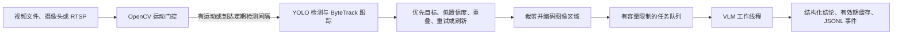

# cascade-vision 中文使用与评测指南

适用版本：`0.3.0`。本文面向首次使用项目的开发者，介绍运行方式、数据输出、评测规则和后续验证工作。

- [项目仓库](https://github.com/x549d/cascade-vision)
- [0.3.0 发布页](https://github.com/x549d/cascade-vision/releases/tag/v0.3.0)
- [中文简介](../README.zh-CN.md)
- [英文接口说明](../README.md)

## 1. 项目定位与当前状态

`cascade-vision` 是一个早期 alpha 阶段的 Python 视频分析库和命令行工具。它先在本地分析画面变化、检测并跟踪目标，再选择部分图像区域交给视觉语言模型（VLM）进行语义判断。

项目希望帮助开发者研究两个问题：哪些画面值得进一步分析，以及筛选策略会怎样影响调用量、事件召回率和处理延迟。

当前已实现运动门控、目标跟踪、异步任务队列、失败恢复、结果刷新、事件导出和带标注的视频对比评测工具。`0.3.0` 的 50 项离线测试及 Windows/Ubuntu、Python 3.9/3.11/3.13 的 CI 检查已通过。

真实视频上的准确率、成本节省和独立使用效果仍需验证。合成演示、模拟判断和 CI 通过只能证明相应流程能够执行，不能据此推导真实场景效果。

## 2. 处理流程



主要模块如下：

| 模块 | 职责 |
| --- | --- |
| `config.py` | 默认配置、环境变量解析与参数校验 |
| `motion.py` | MOG2 运动筛选、图像区域裁剪与编码 |
| `detector.py` | 检测、跟踪、触发条件及审查状态 |
| `vlm_judge.py` | 模型请求、结构化结果、用量读取与显式模拟 |
| `pipeline.py` | 队列、工作线程、缓存、生命周期与汇总统计 |
| `capture.py` | 视频读取、RTSP 超时与有限重连 |
| `events.py` | 线程安全的 JSONL 写入与共享调用次数限制 |
| `evaluation.py` | 视频清单校验、策略对比、事件匹配与评分 |
| `cli.py` | `demo`、`run`、`benchmark` 命令 |

运动门控可能跳过原始帧；目标稳定性按连续的“检测器观测”计数。定期检测机制可让静态画面重新进入检测器，但不能保证发现所有静止目标。

## 3. 安装

项目要求 Python 3.9 或更高版本。以下命令从源码安装，以便同时使用示例脚本。

### Windows PowerShell

```powershell
git clone https://github.com/x549d/cascade-vision.git
cd cascade-vision
python -m venv .venv
.\.venv\Scripts\python.exe -m pip install -e ".[dev]"
```

### Linux 或 macOS

```bash
git clone https://github.com/x549d/cascade-vision.git
cd cascade-vision
python -m venv .venv
.venv/bin/python -m pip install -e ".[dev]"
```

`.[dev]` 包含开发和测试依赖。真实 YOLO 检测需要另行安装 `.[yolo]`，也可使用 `.[all]` 安装全部可选依赖。

首次安装依赖需要网络。安装完成后的合成离线演示不需要摄像头、模型权重或 API 密钥。默认 OpenCV 依赖是无图形界面的版本；终端模式可直接使用，`--show-window` 则需要合适的图形界面环境及 OpenCV 发行包。

## 4. 零 API 预算快速运行

在项目根目录执行：

```powershell
.\.venv\Scripts\python.exe -m cascade_vision.cli demo --mock-vlm --event-labels person,backpack --report-json reports/demo.json --events-jsonl reports/events.jsonl
```

Linux/macOS 可将命令中的解释器路径换成 `.venv/bin/python`。如果已经激活安装环境，也可使用 `cascade-vision demo ...`。

这条命令使用固定种子的合成画面、颜色轮廓检测器和预设的模拟语义结论。它不会调用付费 VLM API。即使环境中已经配置密钥，`demo` 仍使用模拟模式。

输出文件：

| 文件 | 内容 |
| --- | --- |
| `reports/demo.json` | 版本、运行模式与汇总统计 |
| `reports/events.jsonl` | 每次任务的状态、结论、用量与耗时 |

`actual_tokens` 在纯模拟运行中应为 `0`。模拟结论中的“快递员”“无人看管背包”等文字来自预设规则，不代表模型识别了这些语义。

同一路径的报告和事件文件会被新一次运行覆盖。需要保留多次实验时，应为每次实验使用不同文件名或目录。

## 5. 无本地素材时运行对比工具

项目可以自行生成合成视频和配套标注，不需要额外下载视频。

```powershell
$env:CASCADE_MOCK_LATENCY_S = "0"
$env:CASCADE_MAX_QUEUE_SIZE = "1000"
.\.venv\Scripts\python.exe examples/generate_fixture.py --output-dir reports/fixture
.\.venv\Scripts\python.exe -m cascade_vision.cli benchmark --manifest reports/fixture/manifest.json --output-dir reports/comparison --mock-vlm --yolo-model mock
```

Linux/macOS 的对应配置方式为：

```bash
export CASCADE_MOCK_LATENCY_S=0
export CASCADE_MAX_QUEUE_SIZE=1000
.venv/bin/python examples/generate_fixture.py --output-dir reports/fixture
.venv/bin/python -m cascade_vision.cli benchmark --manifest reports/fixture/manifest.json --output-dir reports/comparison --mock-vlm --yolo-model mock
```

上述环境变量会影响当前终端中后续启动的进程。`mock_latency_s=0` 用于加快流程验证；较大的队列容量可降低非实时合成测试中因集中入队造成的丢弃概率。

默认比较三种策略：

| 策略 | 行为 |
| --- | --- |
| `interval` | 按固定时间间隔抽取完整画面，默认间隔为 1 秒 |
| `motion` | 对通过运动门控的完整画面发起审查 |
| `cascade` | 通过检测、跟踪和触发规则筛选目标区域 |
| `full` | 每帧完整画面都产生审查任务；需显式加入策略列表 |

主报告位于 `reports/comparison/benchmark.json`，每个视频与策略组合还会生成一个 JSONL 文件。合成离线运行会出现 `synthetic_footage` 和 `simulation` 标记，`comparison_ready` 为 `false`；这是对验证范围的说明。

## 6. 对真实视频进行本地检测

获得有权处理的视频后，可以先运行真实 YOLO，并保持 VLM 为模拟模式：

```powershell
.\.venv\Scripts\python.exe -m pip install -e ".[yolo]"
.\.venv\Scripts\python.exe -m cascade_vision.cli run --source local/video.mp4 --mock-vlm --headless --max-frames 300 --report-json reports/local.json --events-jsonl reports/local-events.jsonl
```

首次加载 YOLO 时可能下载权重。这种运行可检查本地检测、跟踪、触发和任务处理，但语义结论仍是模拟结果。

真实 YOLO 加载失败时程序会报错；空检测不会自动改用颜色轮廓检测器。需要演示检测器时，应显式传入 `--yolo-model mock`。

## 7. 真实 VLM 与带标注评测

本节用于将来具备授权素材和 API 预算时参考。零 API 预算阶段继续使用前述模拟命令。

真实 VLM 模式需要 `OPENAI_API_KEY`，会向配置的服务商发送图像区域，并可能产生费用。缺少密钥时，普通真实模式会明确失败。

带标注评测从 [真实视频清单模板](../examples/real-video-manifest.json) 开始。每段视频应记录：

- 唯一的片段 ID 和相对于清单文件的视频路径。
- 授权或许可证说明，以及准确的 `footage_type`。
- 固定的事件词表 `event_labels`。
- 事件 ID、标签、开始时间 `start_s` 和结束时间 `end_s`。

当前评测器使用恒定帧率视频的帧索引和 FPS 生成媒体时间戳。视频应能读取到有效 FPS、总帧数和时长；事件区间不能超过视频时长。

真实 API 对比需要同时指定 `--allow-api` 和大于零的 `--max-api-calls`。例如：

```text
cascade-vision benchmark --manifest local/manifest.json --output-dir reports/real --strategies interval,motion,cascade --allow-api --max-api-calls 100 --realtime
```

其中 `100` 只是命令示例，表示所有片段和策略共享的总尝试次数上限，包括失败与重试。它不是美元额度上限。如果前面的策略用完额度，后面的策略会被标记为不完整。

`--realtime` 按视频时间推进播放，用于事件到结论的延迟评测。未启用该选项时，事件延迟指标保留为 `null`，仍可查看吞吐、请求耗时和其他结果。

## 8. 如何理解评分

评测器先按标签合并相邻预测点，再将预测事件与真实标注逐一匹配。默认合并间隔为 1 秒，可用 `--merge-gap-s` 调整。

匹配需要标签一致，并至少存在一个落入真实事件区间的有效预测点。每个预测事件最多匹配一个真实事件，反之亦然。模型拒答、失败、未发送任务、无效目标及未应用的旧结果不会被当成成功预测。

| 指标 | 含义 |
| --- | --- |
| `true_positives` | 成功匹配的事件数 |
| `false_positives` | 未匹配的预测事件数 |
| `false_negatives` | 未被发现的标注事件数 |
| `precision` | 预测中正确事件所占比例 |
| `recall` | 真实事件被发现的比例 |
| `f1` | 精确率与召回率的综合指标 |
| `false_alarms_per_hour` | 按视频时长换算的每小时误报数 |
| `event_to_verdict_p50_s` / `p95_s` | 实时节奏回放中，匹配事件从出现到结论完成的延迟 |

不存在可计算分母时，相应指标为 `null`。延迟只覆盖匹配成功的事件，因此应与召回率一起阅读。

这些标注描述的是片段中某类事件是否出现，并不衡量目标身份、定位精度或复杂的多帧交互。合并间隔也会改变事件数量，比较不同策略时应保持一致。

## 9. 事件文件与程序接入

JSONL 每行是一个 JSON 对象。以下是模拟完成事件的精简示意，省略了时间戳、会话 ID、边界框及耗时等字段：

```json
{
  "schema_version": 1,
  "status": "completed",
  "frame_idx": 108,
  "track_id": 1,
  "stream_epoch": 0,
  "attempt": 1,
  "simulated": true,
  "applied": true,
  "prompt_tokens": 0,
  "completion_tokens": 0,
  "verdict": {
    "is_valid_target": true,
    "refined_category": "courier",
    "activity_summary": "模拟活动描述",
    "risk_level": "NONE",
    "observed_events": ["person"]
  }
}
```

主要状态包括：`completed`（完成）、`failed`（失败）、`dropped`（队列满）、`expired`（任务过期）、`budget_rejected`（达到次数限制）、`cancelled`（关闭时取消），以及 RTSP 断开和重连状态。

跟踪 ID 只在特定运行与连接代次内有意义，接入系统时应同时保存 `session_id`、`stream_epoch` 和 `track_id`。

这些记录可以用于在原始本地视频中定位待复核时刻、按标签整理事件清单，或向自己的数据库、看板和提醒规则提供输入。汇总指标则帮助调整采样、排队和并发配置；策略评分用于比较特定素材上的召回率、误报与用量。重复记录不等同于独立人数或实际事件次数。

Python 接入示例：

```python
from cascade_vision import CascadeConfig, CascadePipeline, JsonlEventWriter
from cascade_vision.cli import generate_synthetic_stream

config = CascadeConfig.from_env(
    mock_vlm=True,
    yolo_model="mock",
    mock_latency_s=0,
    event_labels=["person", "backpack"],
)

with JsonlEventWriter("reports/library-events.jsonl") as writer:
    pipeline = CascadePipeline(config, event_callback=writer.write)
    report = pipeline.run_stream(
        generate_synthetic_stream(),
        source_fps=30,
        max_frames=300,
    )
    print(report.to_dict())
```

每个视频流使用新的 `CascadePipeline`。读取当前有效结论时使用 `get_verdict(track_id)`；直接访问 `verdict_cache` 可能读到已过期条目。自行调用 `process_frame()` 的接入方，应在 `finally` 中调用 `stop_workers()`。

自定义事件回调可能同时被生产线程和工作线程调用，应保证线程安全。回调失败会累加 `event_export_errors`。更多字段见 [事件接口文档](EVENTS.md)。

## 10. 常用配置

配置可通过 `CascadeConfig.from_env()` 的参数或 `CASCADE_<字段名大写>` 环境变量传入；显式参数覆盖环境变量。`OPENAI_API_KEY` 和 `OPENAI_BASE_URL` 也受支持。

| 配置 | 默认值 | 含义 |
| --- | --- | --- |
| `motion_ratio_threshold` | `0.012` | 运动区域占画面的最低比例 |
| `min_stable_frames` | `3` | 首次优先审查所需连续检测观测次数 |
| `cooldown_frames` | `90` | 普通审查之间的原始帧冷却间隔 |
| `detector_refresh_interval_frames` | `30` | 静态画面的定期检测间隔；0 关闭 |
| `refresh_interval_frames` | `300` | 成功结论的帧间隔刷新；0 关闭此项 |
| `verdict_ttl_s` | `60` | 结论有效期和时间刷新条件 |
| `audit_max_retries` | `2` | 首次失败后最多追加两次重试 |
| `retry_backoff_s` / `retry_backoff_max_s` | `1` / `30` | 指数退避初始值与上限，单位秒 |
| `max_queue_size` / `worker_threads` | `20` / `2` | 队列容量与 VLM 工作线程数 |
| `max_task_age_s` | `10` | 待发送任务的最长有效时间 |
| `max_cached_tracks` | `1000` | 缓存目标数量上限 |
| `api_timeout_s` | `10` | 模型请求超时；SDK 自动重试关闭 |
| `rtsp_reconnect_attempts` | `3` | RTSP 连续失败后的最大重连尝试次数 |
| `capture_timeout_ms` | `5000` | RTSP FFmpeg 打开和读取超时 |
| `max_vlm_calls` | `0` | 尝试次数上限；0 表示不限次数 |
| `event_labels` | `[]` | 供模型选择和评测使用的事件词表 |

瞬时故障重试使用后续观测到的新画面，并遵循退避和重试次数限制。拒答、鉴权错误及耗尽重试的目标停止自动重试，直到跟踪状态过期，或显式调用 `tracker.clear_audit_failure(track_id)` 开始新的周期。

刷新任务遵循普通冷却限制；队列满或任务过期会释放尚未发送任务的预约。视频播放完毕后没有新的观测帧，因此不能依赖新帧重试继续恢复已经结束的离线片段。

## 11. 用量、成本和延迟

`actual_tokens` 使用模型响应中的输入与输出用量。传输失败、缺少用量或仍有未完成任务时，完整总量可能为 `null`，已观测的部分用量仍会保留。

`estimated_cost_usd` 需要用户配置输入和输出单价；它不包含缓存折扣、特殊价格或服务商账单调整。图像 token 估算与实际响应用量分开报告，不能将估算当成实际账单。

程序区分以下延迟：

- `queue_wait_ms`：任务创建到工作线程开始处理，包含裁剪编码和等待。
- `service_ms`：模型审查调用的处理时间。
- `request_e2e_ms`：任务创建到结论完成的时间。
- 事件到结论延迟：结合标注和实时节奏回放计算，还包含事件出现到选中画面的等待。

汇总中的延迟分位数使用最近 4,096 次尝试。需要全量精确统计时，应保存并分析 JSONL。FPS 包含最后的队列排空时间。

## 12. 常见问题

| 现象 | 排查方式 |
| --- | --- |
| 缺少 API 密钥而报错 | 零预算运行显式使用 `--mock-vlm`，或直接使用 `demo` |
| YOLO 加载失败 | 检查 `.[yolo]` 依赖、权重路径及首次下载条件 |
| `dropped_tasks` 增长 | 检查处理速度、采样频率与队列容量；扩大队列也会增加等待 |
| `expired_tasks` 增长 | 检查排队时间和 `max_task_age_s`，以及是否发生连接代次切换 |
| `budget_rejected_tasks` 增长 | 已达到尝试次数上限；对比结果应按不完整运行处理 |
| 模型失败后仍无结论 | 查看失败是否可重试、是否达到上限，以及后续是否还有目标观测 |
| 终端正常但窗口打不开 | 默认安装无图形界面 OpenCV，使用终端模式或单独配置 GUI 环境 |
| 合成评测 `comparison_ready=false` | 检查 `synthetic_footage`、`simulation` 与其他质量标记 |
| RTSP 最终报重连耗尽 | 检查源服务可达性；程序不会无限重连，也不会在应用异常中回显源地址 |

RTSP 重连会清除当前跟踪与结论缓存，并增加连接代次。旧连接的延迟结果仍计入实际请求用量，但不能重新填充新连接缓存。本地视频读到结束不会触发 RTSP 重连。

## 13. 当前局限与后续验证

本项目仍需验证小目标、光照变化、摄像机运动、静止物体、跟踪中断和上下文裁剪等情况。目标框重叠只是触发启发式，当前没有完整的多帧交互推理能力。

下一阶段的有效产物包括：授权真实素材与事件标注、固定配置下的重复对比、完整的失败与丢弃记录、独立开发者的安装或集成反馈，以及基于反馈产生的维护记录。

模拟模式可用于检查处理流程、回归测试和接入格式。评估真实识别效果时，应使用有权处理的实际素材、事件标注和真实模型输出。

如需反馈安装、使用或集成问题，可参考 [试用指南](PILOT_GUIDE.md) 和 [反馈模板](../.github/ISSUE_TEMPLATE/pilot-feedback.yml)。

## 14. 开发与许可证

```powershell
.\.venv\Scripts\python.exe -m pytest -q
.\.venv\Scripts\python.exe -m ruff check cascade_vision tests examples
.\.venv\Scripts\python.exe -m ruff format --check cascade_vision tests examples
.\.venv\Scripts\python.exe -m build
```

源代码使用 [MIT 许可证](../LICENSE)。第三方包、模型权重和视频数据保留各自的许可证及使用条件。提交问题或分享日志时，应去除密钥、含凭据的地址、图像载荷和未经同意的个人信息。
