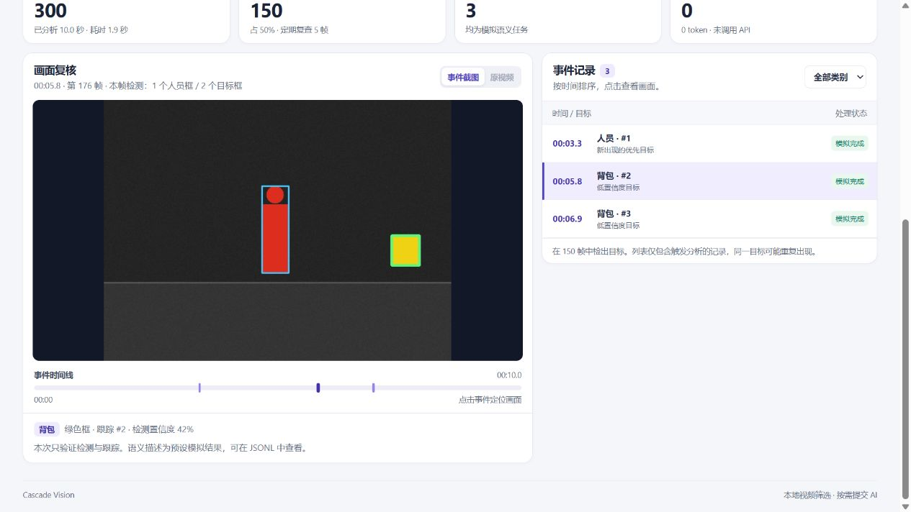

# Local video review tutorial

[中文教程](WEB.md)

Cascade Vision processes video locally and lists selected detections by timestamp. Use the browser workspace to review those events and export records for your own scripts or AI tools.

## Install and start

With Git and Python 3.9 or newer, run the commands below.

```bash
git clone https://github.com/x549d/cascade-vision.git
cd cascade-vision
python -m pip install -e ".[yolo]"
python -m cascade_vision.web
```

Keep the terminal running while you use the Chinese-language interface in your browser. Use `--port 8766` if port 8765 is in use. Press `Ctrl+C` in the terminal to stop the server. [Open the local workspace](http://127.0.0.1:8765)

## Run the offline demo

Select **运行离线演示** (Run offline demo). It processes 300 synthetic frames. Select **背包 · #2** (Backpack #2) to inspect the green box around that event's target and the blue box around another detection in the same frame. For the demo alone, you can install with `python -m pip install -e .` and skip the YOLO extra.



## Import and review a video

1. Drop a video into the import area and select **开始分析** (Analyze). Common containers include MP4, MOV, AVI, WebM, and MKV. The file limit is 256 MiB and the default frame limit is 3,600. The workspace flags a run that stops at the frame limit.
2. Keep **本地检测 · 描述模拟** (Local detection, simulated descriptions) for local YOLO detection and tracking with zero model API requests. The detector may download weights on first use.
3. Filter the event list by category and select a row to see the corresponding frame. Green marks the selected target and blue marks other detections in that frame. Select **原视频** (Original video) to seek to the event timestamp. Event screenshots are available if the browser cannot play the original encoding.
4. Download **汇总 JSON** (Summary JSON) and **事件 JSONL** (Event JSONL) before starting another run. The workspace keeps the latest job for the running server session.

## Use the records with an AI tool

Give the JSONL file to an AI tool that accepts files. Ask it to make a chronological review list with `media_timestamp_s`, `yolo_class`, and `track_id`. A track can appear in several rows. For an activity description or a check of a suspected reflection, attach the corresponding screenshots too.

> Build a review list for person detections. Preserve timestamps, track IDs, and detector confidence. Group repeated observations by track ID and skip simulated semantic descriptions. Flag screenshots that need a human check.

The summary contains the processed range, task counts, and actual API usage. Bounding boxes use the analysis frame size from `analysis_size` in the summary. [Event field reference](EVENTS.md)

## Enable model API requests

Set `OPENAI_API_KEY` in the terminal and start with `python -m cascade_vision.web --allow-api`. Select **真实 AI 分析** (AI analysis), set a request limit from 1 to 50, and confirm. The service receives selected image crops. Requests may incur charges and retries count toward the limit.

Use `--yolo-model path/to/yolo11n.pt` to load local general-purpose weights. If you have your own person-focused weights, add `--person-model path/to/weights.pt` and select **站台人员（实验）** (Experimental person detection). This profile outputs person detections only.
