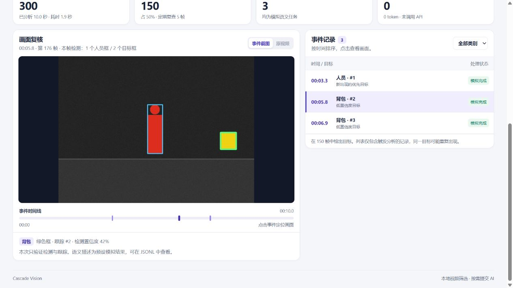

# 视频分析工作台教程

[English tutorial](WEB.en.md)

工作台在本地筛选视频，按时间展示触发分析的目标。你可以复核检测框，导出记录，再交给 AI 整理时间线或分析选中的截图。

## 1. 安装并启动

先安装 Git 和 Python 3.9 或更高版本。在终端运行以下命令。已有项目目录时，在该目录运行后两条命令即可。

```bash
git clone https://github.com/x549d/video-ai-saver.git cascade-vision
cd cascade-vision
python -m pip install -e ".[yolo]"
python -m cascade_vision.web
```

在浏览器打开工作台，保持终端运行。按 `Ctrl+C` 可停止服务。端口占用时，可加 `--port 8766` 并打开对应端口。也可以用安装后提供的 `cascade-vision-ui` 命令启动。 [打开本机工作台](http://127.0.0.1:8765)

## 2. 跑一次离线演示

点击 **运行离线演示**。页面会处理内置的 300 帧合成素材。完成后点 **背包 · #2**，截图里可以看到绿色的背包框和蓝色的同帧人员框。这个演示可以只用 `python -m pip install -e .` 安装，无需 YOLO 权重和 API 密钥。



## 3. 导入并复核自己的视频

1. 拖入或选择 MP4、MOV、AVI、WebM、MKV 等视频，文件大小上限 256 MiB。选定处理范围并点击 **开始分析**。默认处理整段视频，上限 3,600 帧。超出范围时，页面会提示已截断。
2. 默认的 **本地检测 · 描述模拟** 使用 YOLO 检测和跟踪。首次运行可能需要下载 YOLO 权重。结果卡片显示处理帧数、未通过运动筛选的帧数、完成任务和真实 API 请求。部分未通过运动筛选的帧会被定期复查。
3. 在事件列表筛选 **人员** 或其他类别，再选一条记录。绿色框对应这条事件，蓝色框是同帧其他检测结果。点击 **原视频** 可跳到对应时间点。浏览器无法播放该编码时，可用事件截图复核。
4. 下载 **汇总 JSON** 和 **事件 JSONL**。页面保留本次服务会话的最近一次任务，在导入下一段视频前先导出要保存的结果。

分析时会等比缩小长边超过 1,280 像素的帧。导出的目标框坐标对应分析画面，宽高见汇总的 `analysis_size`。播放器使用原视频。

## 4. 把事件记录交给 AI 工具

需要时间线、复核清单或报告时，把 **事件 JSONL** 上传到能读取文件的 AI 工具。每行记录的 `media_timestamp_s` 是视频时间点，`yolo_class` 是检测类别，`track_id` 是跟踪编号。示例只展示部分字段。

```json
{"media_timestamp_s":3.4,"frame_idx":103,"yolo_class":"person","track_id":1,"yolo_conf":0.86,"frame_person_count":1,"simulated":true}
```

> 请从事件记录中提取人员检测，按时间排序。每条保留视频时间点、跟踪编号和检测置信度。请忽略模拟语义描述，把同一跟踪编号的重复记录归组，并保留原始时间点供我回看。如果附有截图，请标记可能的倒影和需要人工复核的项目。

JSONL 只列出触发分析的事件，同一个目标可能重复出现。用它安排回看时段。需要判断人在做什么，或检测框是否落在倒影上时，再附上对应截图。汇总 JSON 可用来查看视频处理范围、任务状态和 API 请求量。 [完整事件字段说明](EVENTS.md)

## 5. 按需启用真实 AI 描述

在启动工作台的终端设置 `OPENAI_API_KEY`，然后运行以下命令。在页面选择 **真实 AI 分析**，设置 1–50 次请求上限并确认。项目会把选中的裁剪图交给模型服务，调用可能产生费用。请求上限按次数计算，包含重试。

```bash
python -m cascade_vision.web --allow-api
```

已有本地通用 YOLO 权重时可使用 `--yolo-model path/to/yolo11n.pt`。已有自己微调的人员权重时，可用 `--person-model path/to/weights.pt` 启动，再选 **站台人员（实验）**，只输出人员框。请用独立于训练数据的视频复核自己的权重。
